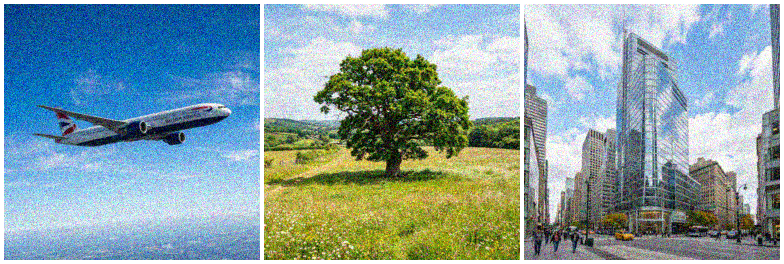
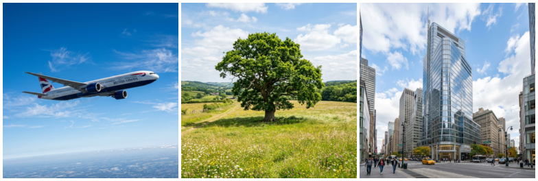

# 🖼️ Image Reconstruction (CUDA Accelerated)

[](https://huggingface.co/spaces/soumyajitpal04/image-denoiser-cuda)
[](https://pytorch.org/)
[](https://developer.nvidia.com/cuda-toolkit)
[](https://en.cppreference.com/)
[](#)

> 🚀 **Interactive Web Showcase:** **[Try the Live Demo on Hugging Face Spaces](https://huggingface.co/spaces/soumyajitpal04/image-denoiser-cuda)** — Drag the interactive split-screen slider to test real-time non-expansive image reconstruction!

This project showcases a high-performance **Non-Expansive Image Denoiser**. Developed as part of my **IISc Research Internship** at the Lab of Imaging Sciences and Algorithms (LISA), this model predicts parallel spatial shifts to reconstruct heavily corrupted images. 

To overcome sequential bottlenecks in native PyTorch loops, I engineered **custom C++/CUDA backend extensions**, achieving a significant **1.5X inference speedup**.

## 📊 Showcase

Here is the model actively reconstructing corrupted images using parallel aggregation:

| Corrupted Input | Reconstructed Output | Perfect Target |
|:---:|:---:|:---:|
|  |  |  |

---

## ✨ Features & Research Highlights
- **Performance Breakthrough**: Achieved a **1.5X execution speedup** compared to standard PyTorch implementation (verified via `benchmark.py`).
- **Custom CUDA Backend**: Wrote specialized `aggregation.cu` and `binding.cpp` kernels for fused image aggregation, entirely bypassing Python-layer loop overhead.
- **Time-Memory Optimization**: Conducted rigorous trade-off analysis to ensure strict numerical accuracy while maximizing GPU VRAM utilization.
- **Parallel Weight Predictor**: A specialized neural network layer that predicts spatial shifts and applies them concurrently across the image matrix.

---

## 🚀 Setup & Execution

### 1. Prerequisites
- Python 3.8+
- PyTorch (with CUDA support matching your NVIDIA driver)
- NVIDIA CUDA Toolkit (required to compile the custom `.pyd` extension)
- A CUDA-capable GPU

### 2. Installation
```bash
git clone https://github.com/Soumyajit-Pal/Image-Reconstruction.git
cd Image-Reconstruction
pip install -r requirements.txt
```

### 3. Compile the CUDA Kernels
You must compile the C++ backend for the model to execute.
```bash
# On Windows (ensure MSVC and CUDA_HOME are configured):
build.bat

# Or manually:
python setup.py build_ext --inplace
```

---

## 🧪 Usage & Testing

### Interactive Web Demo (Gradio)
Launch the interactive web UI locally with auto CUDA/CPU backend detection:
```bash
python app.py
```
Visit `http://localhost:7860` to upload custom images, tweak noise levels, and inspect PSNR/SSIM improvements in real time.

### Interactive Jupyter Demo
The easiest way to test the model's capabilities:
```bash
jupyter notebook demo.ipynb
```
*(Automatically loads pre-trained weights from `weights/denoiser_unified.pth`)*

### Evaluate on Real Images
Run the evaluation script to test the model against standard test images provided in the `test_images/` directory.
```bash
python evaluate_real.py
```
*(Outputs the denoised results to the `assets/` folder).*

### Benchmarking (CUDA vs Native PyTorch)
To scientifically verify the 1.5X speedup achieved by the custom CUDA kernel against the baseline serial implementation:
```bash
python benchmark.py --iterations 10
```
