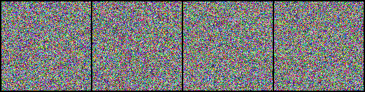
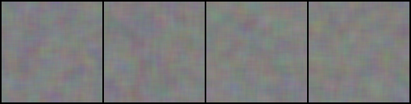
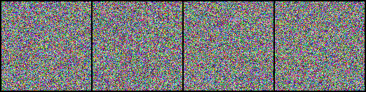

# Image Reconstruction using Custom CUDA Kernels

This project showcases an advanced Machine Learning model for **Image Denoising / Reconstruction**. It utilizes a **Non-Expansive Denoiser architecture** with a **Parallel Weight Predictor**, highly optimized using **Custom CUDA Extensions** for rapid image aggregation.

## Showcase

Here is an example of the model reconstructing a heavily corrupted image:

| Corrupted Input | Reconstructed Output | Perfect Target |
|:---:|:---:|:---:|
|  |  |  |

## Features
- **Custom CUDA Extension**: Features a specialized C++/CUDA backend (`aggregation.cu`, `binding.cpp`) for fused image aggregation that bypasses slow PyTorch loop implementations.
- **Parallel Weight Predictor**: Neural network that predicts spatial shifts and applies them concurrently.
- **High Performance**: Significant speedups in both execution time and memory efficiency over pure-Python equivalents (measured using `benchmark.py`).

## Installation

### 1. Requirements
Ensure you have the following installed:
- Python 3.8+
- PyTorch (with CUDA support matching your local NVIDIA driver)
- NVIDIA CUDA Toolkit (required to compile the extension)

### 2. Setup Environment
```bash
# Clone the repository
git clone https://github.com/YOUR_USERNAME/Image-Reconstruction.git
cd Image-Reconstruction

# Install Python dependencies
pip install -r requirements.txt
```

### 3. Compile the CUDA Extension
You must compile the CUDA backend for the model to run. A build script for Windows is provided.
```bash
# On Windows, run the build script (ensure MSVC and CUDA_HOME are configured):
build.bat

# Or compile manually:
python setup.py build_ext --inplace
```

## Usage

### Interactive Demo
The easiest way to test the model is using the included Jupyter Notebook:
```bash
jupyter notebook demo.ipynb
```
The notebook automatically loads the pre-trained weights (`weights/denoiser_unified.pth`) and runs inference on randomly generated synthetic data.

### Benchmarking
To compare the performance of the Custom CUDA implementation vs. a standard PyTorch implementation:
```bash
run_benchmarks.bat
# Or manually:
python benchmark.py --iterations 10
```
